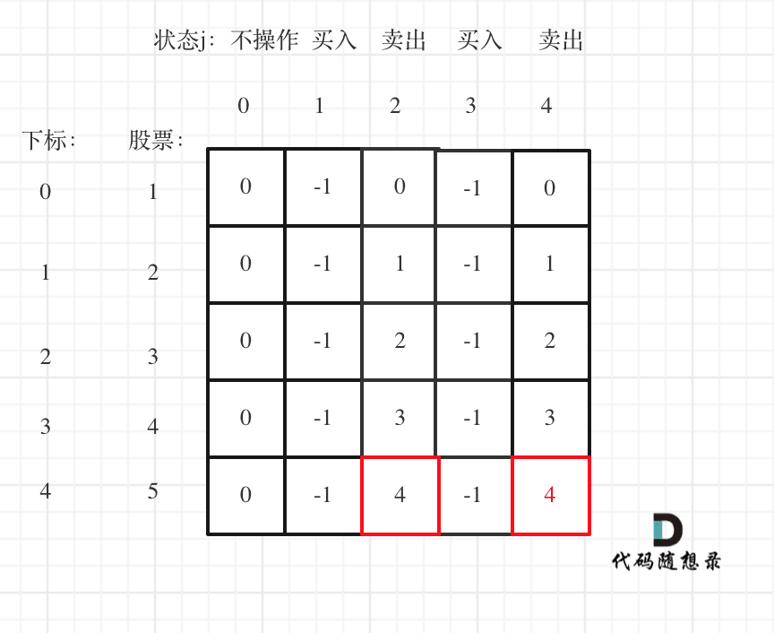
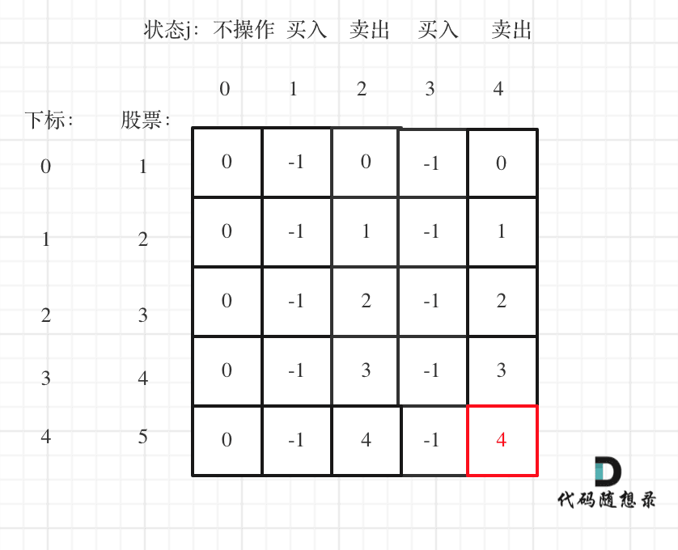
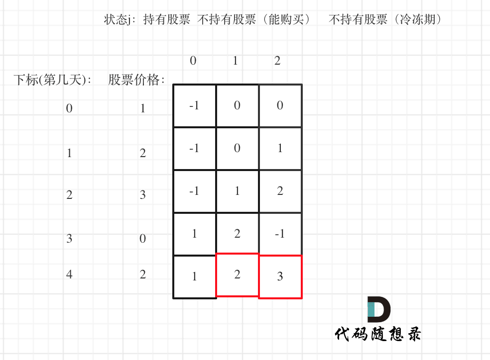

# 本週小結！（動態規劃（dynamic programming, DP）系列七）

本週的主題就是股票系列，來一起回顧一下吧

## 週一

[動態規劃：買賣股票的最佳時機II](https://programmercarl.com/0122.买卖股票的最佳时机II（动态规划）.html)中股票可以買賣多次了！

這也是和[121. 買賣股票的最佳時機](https://programmercarl.com/0121.买卖股票的最佳时机.html)的唯一區別（注意只有一隻股票，所以再次購買前要出售掉之前的股票）

重點在於遞迴公式（recurrence formula）的不同。

再回顧一下 dp 陣列（array）的含義：

* dp[i][0] 表示第 i 天持有股票所得現金。
* dp[i][1] 表示第 i 天不持有股票所得最多現金


遞迴公式：

```
dp[i][0] = max(dp[i - 1][0], dp[i - 1][1] - prices[i]);
dp[i][1] = max(dp[i - 1][1], dp[i - 1][0] + prices[i]);
```

大家可以發現本題和[121. 買賣股票的最佳時機](https://programmercarl.com/0121.买卖股票的最佳时机.html)的程式碼幾乎一樣，唯一的區別在：

```
dp[i][0] = max(dp[i - 1][0], dp[i - 1][1] - prices[i]);
```

**這正是因為本題的股票可以買賣多次！** 所以買入股票的時候，可能會有之前買賣的利潤即：dp[i - 1][1]，所以 dp[i - 1][1] - prices[i]。

## 週二

[動態規劃：買賣股票的最佳時機III](https://programmercarl.com/0123.买卖股票的最佳时机III.html)中最多只能完成兩筆交易。

**這意味著可以買賣一次，可以買賣兩次，也可以不買賣**。


1. 確定 dp 陣列以及下標（subscript）的含義

一天一共有五個狀態（state），

0. 沒有操作
1. 第一次買入
2. 第一次賣出
3. 第二次買入
4. 第二次賣出

**dp[i][j] 中 i 表示第 i 天，j 為 [0 - 4] 五個狀態，dp[i][j] 表示第 i 天狀態 j 所剩最大現金**。

2. 確定遞迴公式

需要注意：dp[i][1]，**表示的是第 i 天，買入股票的狀態，並不是說一定要第 i 天買入股票，這是很多同學容易陷入的誤區**。

```
dp[i][1] = max(dp[i-1][0] - prices[i], dp[i - 1][1]);
dp[i][2] = max(dp[i - 1][1] + prices[i], dp[i - 1][2]);
dp[i][3] = max(dp[i - 1][3], dp[i - 1][2] - prices[i]);
dp[i][4] = max(dp[i - 1][4], dp[i - 1][3] + prices[i]);
```

3. dp 陣列如何初始化（initialization）

dp[0][0] = 0;
dp[0][1] = -prices[0];
dp[0][2] = 0;
dp[0][3] = -prices[0];
dp[0][4] = 0;

4. 確定遍歷（traversal）順序

從遞迴公式其實已經可以看出，一定是從前向後遍歷，因為 dp[i]，依靠 dp[i - 1] 的數值。

5. 舉例推導 dp 陣列

以輸入 [1,2,3,4,5] 為例



可以看到紅色框為最後兩次賣出的狀態。

現在最大的時候一定是賣出的狀態，而兩次賣出的狀態現金最大一定是最後一次賣出。

所以最終最大利潤是 dp[4][4]

## 週三

[動態規劃：買賣股票的最佳時機IV](https://programmercarl.com/0188.买卖股票的最佳时机IV.html)最多可以完成 k 筆交易。

相對於上一道[動態規劃：123.買賣股票的最佳時機III](https://programmercarl.com/0123.买卖股票的最佳时机III.html)，本題需要透過前兩次的交易，來類比前 k 次的交易


1. 確定 dp 陣列以及下標的含義

使用二維（2D）陣列 dp[i][j] ：第 i 天的狀態為 j，所剩下的最大現金是 dp[i][j]

j 的狀態表示為：

* 0 表示不操作
* 1 第一次買入
* 2 第一次賣出
* 3 第二次買入
* 4 第二次賣出
* .....

**除了 0 以外，偶數就是賣出，奇數就是買入**。


2. 確定遞迴公式

還要強調一下：dp[i][1]，**表示的是第 i 天，買入股票的狀態，並不是說一定要第 i 天買入股票，這是很多同學容易陷入的誤區**。

```CPP
for (int j = 0; j < 2 * k - 1; j += 2) {
    dp[i][j + 1] = max(dp[i - 1][j + 1], dp[i - 1][j] - prices[i]);
    dp[i][j + 2] = max(dp[i - 1][j + 2], dp[i - 1][j + 1] + prices[i]);
}
```

**本題和[動態規劃：123.買賣股票的最佳時機III](https://programmercarl.com/0123.买卖股票的最佳时机III.html)最大的區別就是這裡要類比 j 為奇數是買，偶數是賣的狀態**。

3. dp 陣列如何初始化

**dp[0][j] 當 j 為奇數的時候都初始化為 -prices[0]**

程式碼如下：

```CPP
for (int j = 1; j < 2 * k; j += 2) {
    dp[0][j] = -prices[0];
}
```

**在初始化的地方同樣要類比 j 為奇數是買、偶數是賣的狀態**。

4. 確定遍歷順序

從遞迴公式其實已經可以看出，一定是從前向後遍歷，因為 dp[i]，依靠 dp[i - 1] 的數值。

5.  舉例推導 dp 陣列

以輸入 [1,2,3,4,5]，k=2 為例。




最後一次賣出，一定是利潤最大的，dp[prices.size() - 1][2 * k] 即紅色部分就是最後求解。

## 週四

[動態規劃：最佳買賣股票時機含冷凍期](https://programmercarl.com/0309.最佳买卖股票时机含冷冻期.html)盡可能地完成更多的交易（多次買賣一支股票），但有冷凍期，冷凍期為 1 天

相對於[動態規劃：122.買賣股票的最佳時機II](https://programmercarl.com/0122.买卖股票的最佳时机II（动态规划）.html)，本題加上了一個冷凍期


**本題則需要第三個狀態：不持有股票（冷凍期）的最多現金**。

動規五部曲，分析如下：

1. 確定 dp 陣列以及下標的含義

**dp[i][j]，第 i 天狀態為 j，所剩的最多現金為 dp[i][j]**。

j 的狀態為：

* 0：持有股票後的最多現金
* 1：不持有股票（能購買）的最多現金
* 2：不持有股票（冷凍期）的最多現金

2. 確定遞迴公式

```
dp[i][0] = max(dp[i - 1][0], dp[i - 1][1] - prices[i]);
dp[i][1] = max(dp[i - 1][1], dp[i - 1][2]);
dp[i][2] = dp[i - 1][0] + prices[i];
```

3.  dp 陣列如何初始化

可以統一都初始為 0 了。

程式碼如下：
```CPP
vector<vector<int>> dp(n, vector<int>(3, 0));
```

**初始化其實很有講究，很多同學可能是稀里糊塗地全都初始化 0，反正就可以通過，但沒有想清楚，為什麼都初始化為 0**。

4. 確定遍歷順序

從遞迴公式上可以看出，dp[i] 依賴於 dp[i-1]，所以是從前向後遍歷。

5. 舉例推導 dp 陣列

以 [1,2,3,0,2] 為例，dp 陣列如下：




最後兩個狀態 不持有股票（能購買）和 不持有股票（冷凍期）都有可能最後結果，取最大的。

## 總結

下週還會有一篇股票系列的文章，**股票系列後面我也會單獨寫一篇總結，來高度概括一下，這樣大家對股票問題就會有一個整體性的理解了**。


<div align="center"> </img></div>
