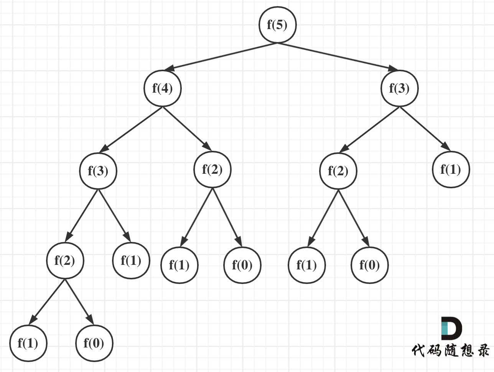
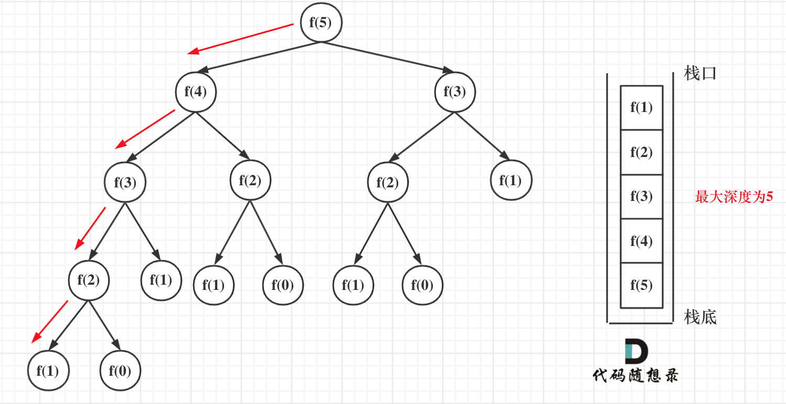
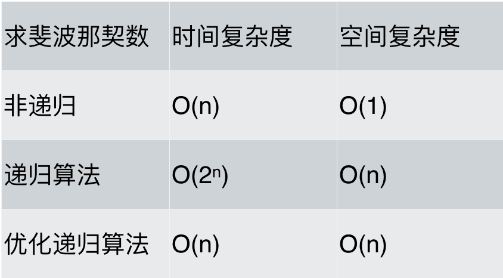

* [做專案（多個 C++、Java、Go、測試開發、前端（front end）專案）](./other/kstar.md)
* [練習演算法（兩個月高強度學演算法）](./xunlian/xunlianying.md)
* [背誦面試必考題（八股文）（40 天挑戰高頻面試題）](./xunlian/bagu.md)
  
  
  
  
  
  
  
  
  
  
  
  
  

# 遞迴（recursion）演算法的時間複雜度（time complexity）與空間複雜度（space complexity）分析！

之前在[透過一道面試題目，講一講遞迴演算法的時間複雜度！](https://programmercarl.com/前序/通过一道面试题目，讲一讲递归算法的时间复杂度！.html)中詳細講解了遞迴演算法的時間複雜度，但沒有講空間複雜度。

本篇將透過求斐波那契序列（Fibonacci sequence）和二分法再來深入分析一波遞迴演算法的時間複雜度和空間複雜度，細心看完，會刷新對遞迴的認知！


## 遞迴求斐波那契序列的效能分析

先來看一下求斐波那契數（Fibonacci number）的遞迴寫法。

```CPP
int fibonacci(int i) {
       if(i <= 0) return 0;
       if(i == 1) return 1;
       return fibonacci(i-1) + fibonacci(i-2);
}
```

對於遞迴演算法來說，程式碼一般都比較簡短，從演算法邏輯上看，所用的儲存空間也非常少，但執行時需要的記憶體（memory）可不見得會少。

### 時間複雜度分析

來看看這個求斐波那契的遞迴演算法的時間複雜度是多少呢？

在講解遞迴時間複雜度的時候，我們提到了遞迴演算法的時間複雜度本質上是要看：**遞迴的次數 * 每次遞迴的時間複雜度**。

可以看出上面的程式碼每次遞迴都是 O(1) 的操作。再來看遞迴了多少次，這裡將 i 為 5 作為輸入的遞迴過程抽象成一棵遞迴樹，如圖：




從圖中可以看出 f(5) 是由 f(4) 和 f(3) 相加而來，那麼 f(4) 是由 f(3) 和 f(2) 相加而來，以此類推。

在這棵二元樹（binary tree）中每一個節點（node）都是一次遞迴，那麼這棵樹有多少個節點呢？

我們之前也有說到，一棵深度（depth）（按根節點（root node）深度為 1）為 k 的二元樹最多可以有 2^k - 1 個節點。

所以該遞迴演算法的時間複雜度為 O(2^n)，這個複雜度是非常大的，隨著 n 的增大，耗時是指數（exponential）上升的。

來做一個實驗，大家可以有一個直觀的感受。

以下為 C++ 程式碼，來測一下，當我們輸入 n 的時候，這段遞迴求斐波那契程式碼的耗時。

```CPP
#include <iostream>
#include <chrono>
#include <thread>
using namespace std;
using namespace chrono;
int fibonacci(int i) {
       if(i <= 0) return 0;
       if(i == 1) return 1;
       return fibonacci(i - 1) + fibonacci(i - 2);
}
void time_consumption() {
    int n;
    while (cin >> n) {
        milliseconds start_time = duration_cast<milliseconds >(
            system_clock::now().time_since_epoch()
        );

        fibonacci(n);

        milliseconds end_time = duration_cast<milliseconds >(
            system_clock::now().time_since_epoch()
        );
        cout << milliseconds(end_time).count() - milliseconds(start_time).count()
            <<" ms"<< endl;
    }
}
int main()
{
    time_consumption();
    return 0;
}
```

根據以上程式碼，給出幾組實驗資料：

測試電腦以 2015 版 MacPro 為例，CPU 組態（configuration）：`2.7 GHz Dual-Core Intel Core i5`

測試資料如下：

* n = 40，耗時：837 ms
* n = 50，耗時：110306 ms

可以看出，O(2^n) 這種指數級別的複雜度是非常大的。

所以這種求斐波那契數的演算法看似簡潔，其實時間複雜度非常高，一般不推薦這樣來實作斐波那契。

其實罪魁禍首就是這裡的兩次遞迴，導致了時間複雜度以指數上升。

```CPP
return fibonacci(i-1) + fibonacci(i-2);
```

可不可以最佳化一下這個遞迴演算法呢？主要是減少遞迴的呼叫次數。

來看一下如下程式碼：

```CPP
// 版本二
int fibonacci(int first, int second, int n) {
    if (n <= 0) {
        return 0;
    }
    if (n < 3) {
        return 1;
    }
    else if (n == 3) {
        return first + second;
    }
    else {
        return fibonacci(second, first + second, n - 1);
    }
}
```

這裡相當於用 first 和 second 來記錄當前相加的兩個數值，此時就不用兩次遞迴了。

因為每次遞迴的時候 n 減 1，即只是遞迴了 n 次，所以時間複雜度是 O(n)。

同理遞迴的深度依然是 n，每次遞迴所需的空間也是常數（constant），所以空間複雜度依然是 O(n)。

程式碼（版本二）的複雜度如下：

* 時間複雜度：O(n)
* 空間複雜度：O(n)

此時再來測一下耗時情況驗證一下：

```CPP
#include <iostream>
#include <chrono>
#include <thread>
using namespace std;
using namespace chrono;
int fibonacci_3(int first, int second, int n) {
    if (n <= 0) {
        return 0;
    }
    if (n < 3) {
        return 1;
    }
    else if (n == 3) {
        return first + second;
    }
    else {
        return fibonacci_3(second, first + second, n - 1);
    }
}

void time_consumption() {
    int n;
    while (cin >> n) {
        milliseconds start_time = duration_cast<milliseconds >(
            system_clock::now().time_since_epoch()
        );

        fibonacci_3(1, 1, n);

        milliseconds end_time = duration_cast<milliseconds >(
            system_clock::now().time_since_epoch()
        );
        cout << milliseconds(end_time).count() - milliseconds(start_time).count()
            <<" ms"<< endl;
    }
}
int main()
{
    time_consumption();
    return 0;
}

```

測試資料如下：

* n = 40，耗時：0 ms
* n = 50，耗時：0 ms

大家此時應該可以看出差距了！！

### 空間複雜度分析

說完了這段遞迴程式碼的時間複雜度，再看看如何求其空間複雜度呢？這裡給大家提供一個公式：**遞迴演算法的空間複雜度 = 每次遞迴的空間複雜度 * 遞迴深度**

為什麼要求遞迴的深度呢？

因為每次遞迴所需的空間都被壓到呼叫堆疊（call stack）裡（這是記憶體管理裡面的資料結構，和演算法裡的堆疊（stack）原理是一樣的），一次遞迴結束，這個堆疊就是把本次遞迴的資料彈出去。所以這個堆疊最大的長度就是遞迴的深度。

此時可以分析這段遞迴的空間複雜度，從程式碼中可以看出每次遞迴所需要的空間大小都是一樣的，所以每次遞迴中需要的空間是一個常數，並不會隨著 n 的變化而變化，每次遞迴的空間複雜度就是 $O(1)$。

再看遞迴的深度是多少呢？如圖所示：




遞迴第 n 個斐波那契數的話，遞迴呼叫堆疊的深度就是 n。

那麼每次遞迴的空間複雜度是 O(1)，呼叫堆疊深度為 n，所以這段遞迴程式碼的空間複雜度就是 O(n)。

```CPP
int fibonacci(int i) {
       if(i <= 0) return 0;
       if(i == 1) return 1;
       return fibonacci(i-1) + fibonacci(i-2);
}
```


最後對各種求斐波那契序列方法的效能做一下分析，如圖：


 

可以看出，求斐波那契數的時候，使用遞迴演算法不一定在效能上是最優的，但遞迴確實簡化了程式碼層面的複雜度。

### 二分法（遞迴實作）的效能分析

帶大家再分析一段二元搜尋（binary search）的遞迴實作。

```CPP
int binary_search( int arr[], int l, int r, int x) {
    if (r >= l) {
        int mid = l + (r - l) / 2;
        if (arr[mid] == x)
            return mid;
        if (arr[mid] > x)
            return binary_search(arr, l, mid - 1, x);
        return binary_search(arr, mid + 1, r, x);
    }
    return -1;
}
```

都知道二元搜尋的時間複雜度是 O(logn)，那麼遞迴二元搜尋的空間複雜度是多少呢？

我們依然看 **每次遞迴的空間複雜度和遞迴的深度**

每次遞迴的空間複雜度可以看出主要就是參數（parameter）裡傳入的這個 arr 陣列（array），但需要注意的是在 C/C++ 中函數（function）傳遞陣列參數，不是整個陣列複製一份傳入函數而是傳入的陣列首元素位址（address）。

**也就是說每一層遞迴都是共用一塊陣列位址空間的**，所以每次遞迴的空間複雜度是常數即：O(1)。

再來看遞迴的深度，二元搜尋的遞迴深度是 logn，遞迴深度就是呼叫堆疊的長度，那麼這段程式碼的空間複雜度為 1 * logn = O(logn)。

大家要注意自己所用的語言在傳遞函數參數時，是複製整個數值還是複製位址，如果是複製整個數值那麼該二分法的空間複雜度就是 O(nlogn)。


## 總結

本章我們詳細分析了遞迴實作的求斐波那契和二分法的空間複雜度，同時也對時間複雜度做了分析。

特別是兩種遞迴實作的求斐波那契序列，其時間複雜度截然不同，我們還做了實驗，驗證了時間複雜度為 O(2^n) 是非常耗時的。

透過本篇大家應該對遞迴演算法的時間複雜度和空間複雜度有更加深刻的理解了。


