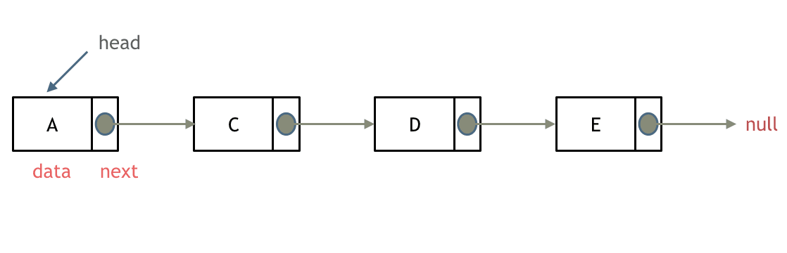
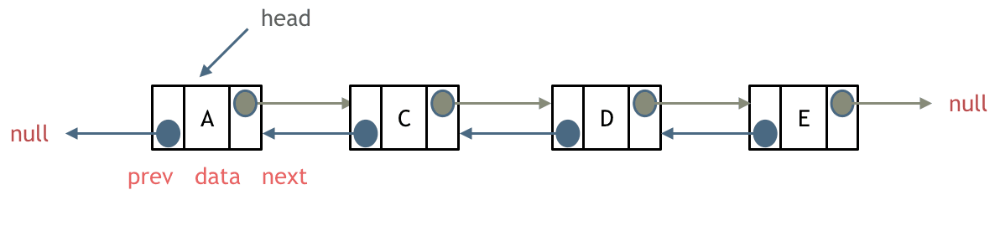
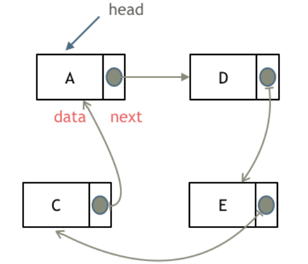
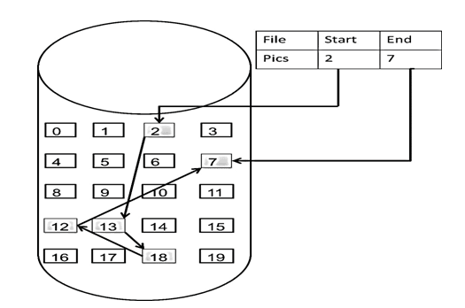
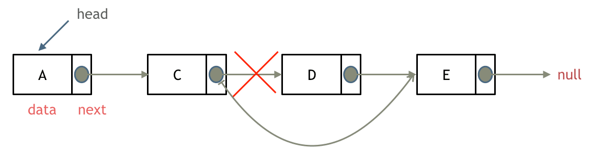
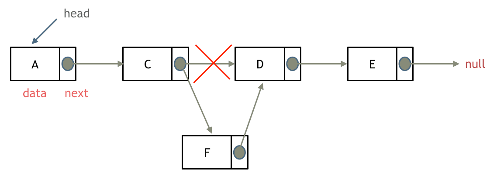
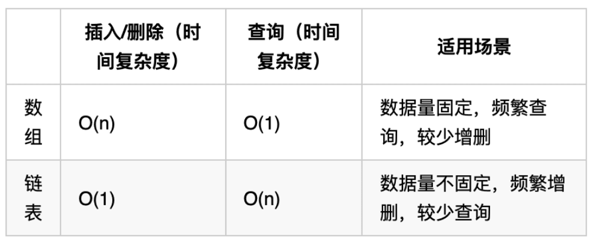

* [做專案（多個 C++、Java、Go、測試開發、前端（front end）專案）](https://www.programmercarl.com/other/kstar.html)
* [練習演算法（algorithm）（兩個月高強度學演算法）](https://www.programmercarl.com/xunlian/xunlianying.html)
* [背誦面試必考題（八股文）（40 天挑戰高頻面試題）](https://www.programmercarl.com/xunlian/bagu.html)


# 關於鏈接串列（linked list），你該了解這些！

什麼是鏈接串列？鏈接串列是一種透過指標（pointer）串聯在一起的線性結構（linear structure），每一個節點（node）由兩部分組成，一個是資料域，一個是指標域（存放指向下一個節點的指標），最後一個節點的指標域指向 null（空指標（null pointer）的意思）。

鏈接串列的入口節點稱為鏈接串列的頭節點（head node），也就是 head。

如圖所示：


## 鏈接串列的類型

接下來說一下鏈接串列的幾種類型：

### 單向鏈接串列（singly-linked list）

剛剛說的就是單向鏈接串列。

### 雙鏈接串列（doubly linked list）

單向鏈接串列中的指標域只能指向節點的下一個節點。

雙鏈接串列：每一個節點有兩個指標域，一個指向下一個節點，一個指向上一個節點。

雙鏈接串列既可以向前查詢也可以向後查詢。

如圖所示：


### 循環鏈接串列（circular linked list）

循環鏈接串列，顧名思義，就是鏈接串列首尾相連。

循環鏈接串列可以用來解決約瑟夫問題。




## 鏈接串列的儲存方式

了解完鏈接串列的類型，再來說一說鏈接串列在記憶體（memory）中的儲存方式。

陣列（array）在記憶體中是連續分布的，但是鏈接串列在記憶體中可不是連續分布的。

鏈接串列是透過指標域的指標連結在記憶體中的各個節點。

所以鏈接串列中的節點在記憶體中不是連續分布的，而是散亂分布在記憶體中的某位址（address）上，分配機制取決於作業系統的記憶體管理。

如圖所示：



這個鏈接串列起始節點為 2，終止節點為 7，各個節點分布在記憶體的不同位址空間上，透過指標串聯在一起。

## 鏈接串列的定義

接下來說一說鏈接串列的定義。

鏈接串列節點的定義，很多同學在面試的時候都寫不好。

這是因為平時在刷 LeetCode 的時候，鏈接串列的節點都預設（default）定義好了，直接用就行了，所以同學們都沒有注意到鏈接串列的節點是如何定義的。

而在面試的時候，一旦要自己手寫鏈接串列，就寫得錯漏百出。

這裡我給出 C/C++ 的定義鏈接串列節點方式，如下所示：

```cpp
// 單向鏈接串列
struct ListNode {
    int val;  // 節點上儲存的元素
    ListNode *next;  // 指向下一個節點的指標
    ListNode(int x) : val(x), next(NULL) {}  // 節點的建構子
};
```

有同學說了，我不定義建構子（constructor）行不行，答案是可以的，C++ 預設生成一個建構子。

但是這個建構子不會初始化（initialization）任何成員變數（variable），下面我來舉兩個例子：

透過自己定義建構子初始化節點：

```cpp
ListNode* head = new ListNode(5);
```

使用預設建構子初始化節點：

```cpp
ListNode* head = new ListNode();
head->val = 5;
```

所以如果不定義建構子而使用預設建構子的話，在初始化的時候就不能直接給變數賦值（assignment）！

## 鏈接串列的操作

### 刪除節點

刪除 D 節點，如圖所示：



只要將 C 節點的 next 指標指向 E 節點就可以了。

那有同學說了，D 節點不是依然存留在記憶體裡嗎？只不過是沒有在這個鏈接串列裡而已。

是這樣的，所以在 C++ 裡最好是再手動釋放這個 D 節點，釋放這塊記憶體。

其他語言例如 Java、Python，就有自己的記憶體回收機制，就不用自己手動釋放了。

### 添加節點

如圖所示：



可以看出鏈接串列的增添和刪除都是 O(1) 操作，也不會影響到其他節點。

但是要注意，要是刪除第五個節點，需要從頭節點查找到第四個節點透過 next 指標進行刪除操作，查找的時間複雜性（time complexity）是 O(n)。

## 效能分析

再把鏈接串列的特性和陣列的特性進行一個對比，如圖所示：



陣列在定義的時候，長度就是固定的，如果想改動陣列的長度，就需要重新定義一個新的陣列。

鏈接串列的長度可以是不固定的，並且可以動態增刪，適合資料量不固定，頻繁增刪，較少查詢的場景。

相信大家已經對鏈接串列足夠了解，後面我會講解關於鏈接串列的高頻面試題目，我們下期見！


## 其他語言版本

### Java：

```java
public class ListNode {
    // 節點的值
    int val;

    // 下一個節點
    ListNode next;

    // 節點的建構子（無參數）
    public ListNode() {
    }

    // 節點的建構子（有一個參數）
    public ListNode(int val) {
        this.val = val;
    }

    // 節點的建構子（有兩個參數）
    public ListNode(int val, ListNode next) {
        this.val = val;
        this.next = next;
    }
}
```

### JavaScript:

```javascript
class ListNode {
  val;
  next = null;
  constructor(value) {
    this.val = value;
    this.next = null;
  }
}
```

### TypeScript:

```typescript
class ListNode {
  public val: number;
  public next: ListNode|null = null;
  constructor(value: number) {
    this.val = value;
    this.next = null;
  }
}
```

### Python：

```python
class ListNode:
    def __init__(self, val, next=None):
        self.val = val
        self.next = next
```

### Go：

```go
type ListNode struct {
    Val int
    Next *ListNode
}
```

### Scala:

```scala
class ListNode(_x: Int = 0, _next: ListNode = null) {
  var next: ListNode = _next
  var x: Int = _x
}
```

### Rust:

```rust
#[derive(PartialEq, Eq, Clone, Debug)]
pub struct ListNode<T> {
    pub val: T,
    pub next: Option<Box<ListNode<T>>>,
}

impl<T> ListNode<T> {
    #[inline]
    fn new(val: T, node: Option<Box<ListNode<T>>>) -> Self {
        ListNode { next: node, val }
    }
}
```


### C:

```c
typedef struct ListNodeT {
    int val;
    struct ListNodeT next;
} ListNode;
```

### C#

```c#
public class Node<T>
{
    // 節點儲存的資料
    public T Data { get; set; }

    // 指向下一個節點的參考
    public Node<T> Next { get; set; }

    // 節點的建構子，用於初始化節點
    public Node(T data)
    {
        Data = data;
        Next = null; // 初始時沒有下一個節點，因此設為 null
    }
}
```


