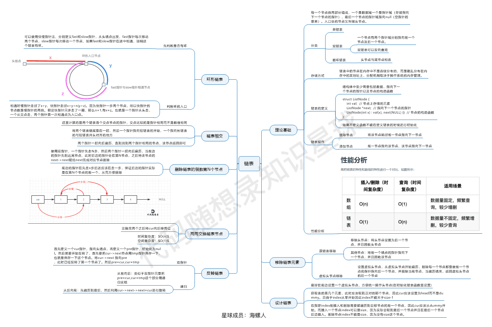

* [做專案（多個 C++、Java、Go、測試開發、前端（front end）專案）](https://www.programmercarl.com/other/kstar.html)
* [練習演算法（兩個月高強度學演算法）](https://www.programmercarl.com/xunlian/xunlianying.html)
* [背誦面試必考題（八股文）（40 天挑戰高頻面試題）](https://www.programmercarl.com/xunlian/bagu.html)

# 鏈接串列（linked list）總結篇

## 鏈接串列的理論基礎

在這篇文章[關於鏈接串列，你該了解這些！](https://programmercarl.com/链表理论基础.html)中，介紹了如下幾點：

* 鏈接串列的種類主要為：單向鏈接串列（singly-linked list）、雙鏈接串列（doubly linked list）、循環鏈接串列（circular linked list）
* 鏈接串列的儲存方式：鏈接串列的節點（node）在記憶體（memory）中是分散儲存的，透過指標（pointer）連在一起。
* 鏈接串列是如何進行新增、刪除、修改、查詢的。
* 陣列（array）和鏈接串列在不同場景下的效能分析。

**可以說把鏈接串列基礎的知識都概括了，但又不像教科書那樣的繁瑣**。

## 鏈接串列經典題目

### dummy head

在[鏈接串列：聽說用 dummy head 會方便很多？](https://programmercarl.com/0203.移除链表元素.html)中，我們講解了鏈接串列操作中一個非常重要的技巧：dummy head。

鏈接串列的一大問題就是操作當前節點必須要找前一個節點才能操作。這就造成了頭節點（head node）的尷尬，因為頭節點沒有前一個節點了。

**每次對應頭節點的情況都要單獨處理，所以使用 dummy head 的技巧，就可以解決這個問題**。

在[鏈接串列：聽說用 dummy head 會方便很多？](https://programmercarl.com/0203.移除链表元素.html)中，我給出了用 dummy head 和沒用 dummy head 的程式碼，大家對比一下就會發現，使用 dummy head 的好處。

### 鏈接串列的基本操作

在[鏈接串列：一道題目考察了常見的五個操作！](https://programmercarl.com/0707.设计链表.html)中，我們透過設計鏈接串列把鏈接串列常見的五個操作練習了一遍。

這是練習鏈接串列基礎操作的非常好的一道題目，考察了：

* 取得鏈接串列第 index 個節點的數值
* 在鏈接串列的最前面插入一個節點
* 在鏈接串列的最後面插入一個節點
* 在鏈接串列第 index 個節點前面插入一個節點
* 刪除鏈接串列的第 index 個節點的數值

**可以說把這道題目做了，鏈接串列基本操作就 OK 了，再也不用擔心鏈接串列新增、刪除、修改、查詢搞不明白了**。

這裡我依然使用了 dummy head 的技巧，大家複習的時候，可以去看一下程式碼。

### 反轉鏈接串列

在[鏈接串列：聽說過兩天反轉鏈接串列又寫不出來了？](https://programmercarl.com/0206.翻转链表.html)中，講解了如何反轉（reverse）鏈接串列。

因為反轉鏈接串列的程式碼相對簡單，有的同學可能直接背下來了，但一寫還是容易出問題。

反轉鏈接串列是面試中高頻題目，很考察面試者對鏈接串列操作的熟練程度。

我在[文章](https://programmercarl.com/0206.翻转链表.html)中，給出了兩種反轉的方式，疊代（iteration）法和遞迴（recursion）法。

建議大家先學透疊代法，然後再看遞迴法，因為遞迴法比較繞，如果疊代還寫不明白，遞迴基本也寫不明白了。

**可以先透過疊代法，徹底弄清楚鏈接串列反轉的過程！**

### 刪除倒數第 N 個節點

在[鏈接串列：刪除鏈接串列倒數第 N 個節點，怎麼刪？](https://programmercarl.com/0019.删除链表的倒数第N个节点.html)中我們結合 dummy head 和 two pointers 法來移除鏈接串列倒數第 N 個節點。

### 鏈接串列相交

[鏈接串列：鏈接串列相交](https://programmercarl.com/面试题02.07.链表相交.html)使用 two pointers 來找到兩個鏈接串列的交點（參考（reference）完全相同，即：記憶體位址（address）完全相同的交點）

### 環形鏈接串列

在[鏈接串列：環找到了，那入口呢？](https://programmercarl.com/0142.环形链表II.html)中，講解了在鏈接串列如何找環，以及如何找環的入口位置。

這道題目可以說是鏈接串列比較難的題目了。但程式碼卻十分簡潔，主要在於一些數學證明。

## 總結

這個圖是 [程式碼隨想錄知識星球](https://programmercarl.com/other/kstar.html) 成員：[海螺人](https://wx.zsxq.com/dweb2/index/footprint/844412858822412) 所畫，總結得非常好，分享給大家。

考察鏈接串列的操作其實就是考察指標的操作，是面試中的常見類型。

鏈接串列篇中開頭介紹[鏈接串列理論知識](https://programmercarl.com/0203.移除链表元素.html)，然後分別透過經典題目介紹了如下知識點：

1. [關於鏈接串列，你該了解這些！](https://programmercarl.com/链表理论基础.html)
2. [dummy head 的技巧](https://programmercarl.com/0203.移除链表元素.html)
3. [鏈接串列的新增、刪除、修改、查詢](https://programmercarl.com/0707.设计链表.html)
4. [反轉一個鏈接串列](https://programmercarl.com/0206.翻转链表.html)
5. [刪除倒數第 N 個節點](https://programmercarl.com/0019.删除链表的倒数第N个节点.html)
6. [鏈接串列相交](https://programmercarl.com/面试题02.07.链表相交.html)
7. [有否環形，以及環的入口](https://programmercarl.com/0142.环形链表II.html)

