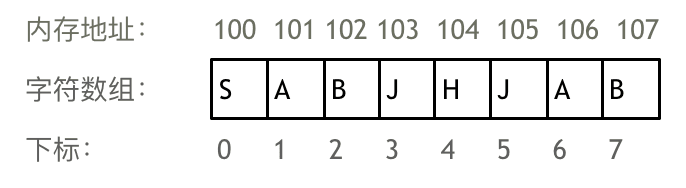
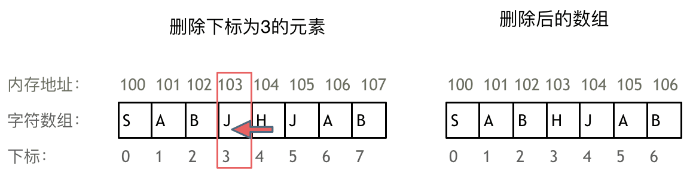
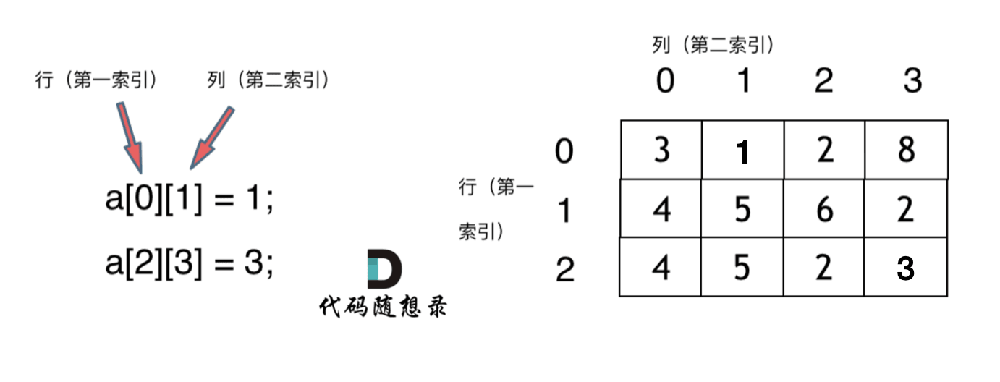
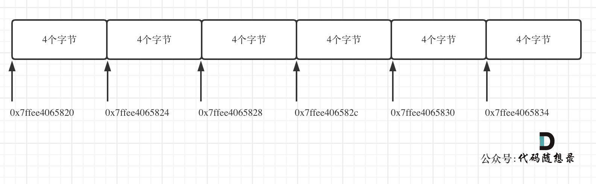
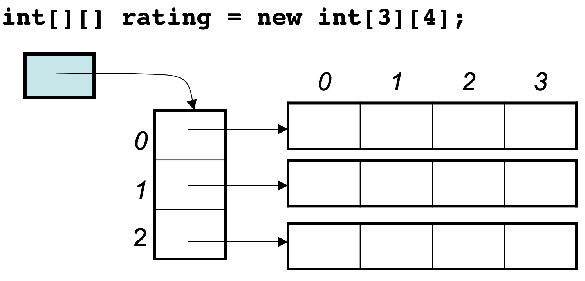

* [做專案（多個 C++、Java、Go、測開、前端專案）](https://www.programmercarl.com/other/kstar.html)
* [刷演算法（兩個月高強度學演算法）](https://www.programmercarl.com/xunlian/xunlianying.html)
* [背八股（40 天挑戰高頻面試題）](https://www.programmercarl.com/xunlian/bagu.html)


# 陣列理論基礎

陣列（array）是非常基礎的資料結構，在面試中，考察陣列的題目一般在思維上都不難，主要是考察對程式碼的掌控能力。

也就是說，想法很簡單，但實作起來可能就不是那麼回事了。

首先要知道陣列在記憶體（memory）中的儲存方式，這樣才能真正理解陣列相關的面試題。

**陣列是存放在連續記憶體空間上的相同類型資料的集合。**

陣列可以方便地透過下標（subscript）索引（index）的方式取得到下標對應的資料。

舉一個字元（character）陣列的例子，如圖所示：




需要兩點注意的是

* **陣列下標都是從 0 開始的。**
* **陣列記憶體空間的位址（address）是連續的**

正是**因為陣列在記憶體空間的位址是連續的，所以我們在刪除或者增添元素（element）的時候，就難免要移動其他元素的位址。**

例如刪除下標為 3 的元素，需要對下標為 3 的元素後面的所有元素都要做移動操作，如圖所示：




而且大家如果使用 C++ 的話，要注意 vector 和 array 的區別，vector 的底層實作是 array，嚴格來講 vector 是容器（container），不是陣列。

**陣列的元素是不能刪的，只能覆蓋。**

那麼二維（two-dimensional）陣列直接上圖，大家應該就知道怎麼回事了



**那麼二維陣列在記憶體的空間位址是連續的嗎？**

不同程式設計語言（programming language）的記憶體管理是不一樣的，以 C++ 為例，在 C++ 中二維陣列是連續分佈的。

我們來做一個實驗，C++ 測試程式碼如下：

```CPP
void test_arr() {
    int array[2][3] = {
		{0, 1, 2},
		{3, 4, 5}
    };
    cout << &array[0][0] << " " << &array[0][1] << " " << &array[0][2] << endl;
    cout << &array[1][0] << " " << &array[1][1] << " " << &array[1][2] << endl;
}

int main() {
    test_arr();
}

```

測試位址為

```
0x7ffee4065820 0x7ffee4065824 0x7ffee4065828
0x7ffee406582c 0x7ffee4065830 0x7ffee4065834
```

注意位址為十六進位（hexadecimal），可以看出二維陣列位址是連續一條線的。

一些讀者可能看不懂記憶體位址，我就簡單介紹一下，0x7ffee4065820 與 0x7ffee4065824 差了一個 4，就是 4 個位元組（byte），因為這是一個 int 型的陣列，所以兩個相鄰陣列元素位址差 4 個位元組。

0x7ffee4065828 與 0x7ffee406582c 也是差了 4 個位元組，在十六進位裡 8 + 4 = c，c 就是 12。

如圖：




**所以可以看出在 C++ 中二維陣列在位址空間上是連續的**。

像 Java 是沒有指標（pointer）的，同時也不對程式設計師暴露其元素的位址，定址（addressing）操作完全交給虛擬機器（virtual machine）。

所以看不到每個元素的位址情況，這裡我以 Java 為例，也做一個實驗。

```Java
public static void test_arr() {
    int[][] arr = {{1, 2, 3}, {3, 4, 5}, {6, 7, 8}, {9,9,9}};
    System.out.println(arr[0]);
    System.out.println(arr[1]);
    System.out.println(arr[2]);
    System.out.println(arr[3]);
}
```
輸出的位址為：

```
[I@7852e922
[I@4e25154f
[I@70dea4e
[I@5c647e05
```

這裡的數值也是十六進位，這不是真正的位址，而是經過處理過後的數值了，我們也可以看出，二維陣列的每一列頭節點（head node）的位址是沒有規則的，更談不上連續。

所以 Java 的二維陣列可能是如下排列的方式：




這裡面試中陣列相關的理論知識就介紹完了。


