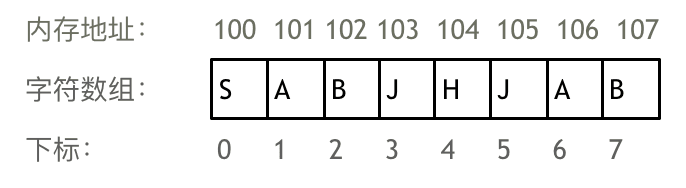
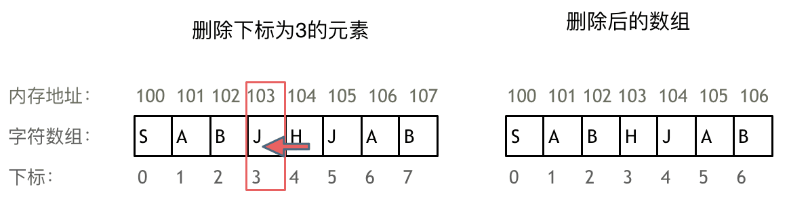
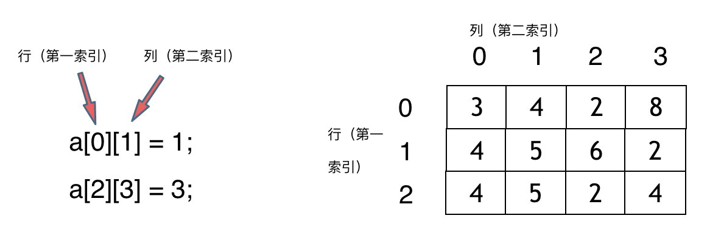
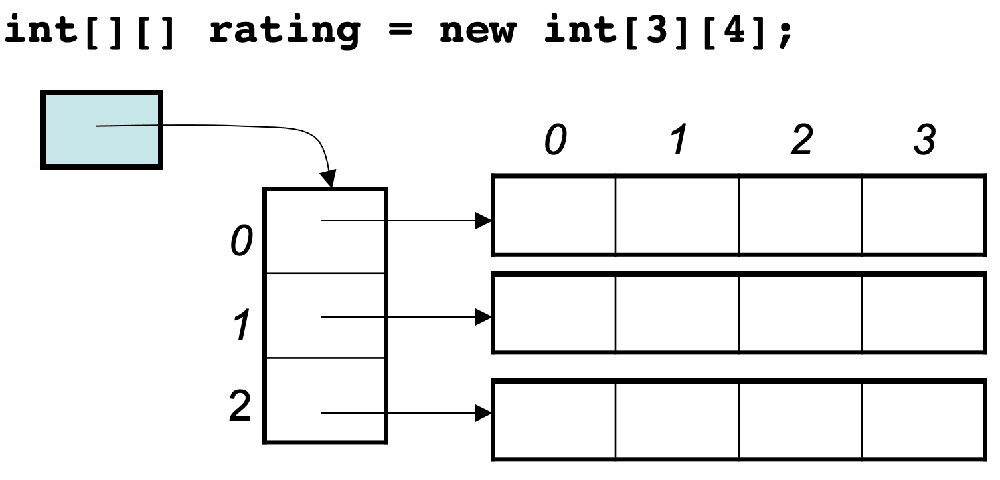
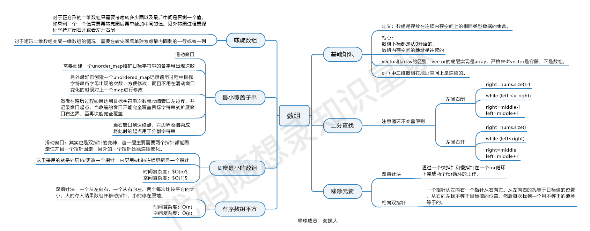

* [做專案（多個 C++、Java、Go、測開、前端專案）](https://www.programmercarl.com/other/kstar.html)
* [刷演算法（兩個月高強度學演算法）](https://www.programmercarl.com/xunlian/xunlianying.html)
* [背八股（40 天挑戰高頻面試題）](https://www.programmercarl.com/xunlian/bagu.html)

# 陣列總結篇

## 陣列理論基礎

陣列（array）是非常基礎的資料結構（data structure），在面試中，考察陣列的題目一般在思維上都不難，主要是考察對程式碼的掌控能力。

也就是說，想法很簡單，但實作起來可能就不是那麼回事了。

首先要知道陣列在記憶體（memory）中的儲存方式，這樣才能真正理解陣列相關的面試題。

**陣列是存放在連續記憶體空間上的相同類型資料的集合。**

陣列可以方便地透過下標（subscript）索引（index）的方式取得到下標對應的資料。

舉一個字元（character）陣列的例子，如圖所示：

 </img>

需要兩點注意的是

* **陣列下標都是從 0 開始的。**
* **陣列記憶體空間的位址（address）是連續的**

正是**因為陣列在記憶體空間的位址是連續的，所以我們在刪除或者增添元素（element）的時候，就難免要移動其他元素的位址。**

例如刪除下標為 3 的元素，需要對下標為 3 的元素後面的所有元素都要做移動操作，如圖所示：

 </img>

而且大家如果使用 C++ 的話，要注意 vector 和 array 的區別，vector 的底層實作是 array，嚴格來講 vector 是容器（container），不是陣列。

**陣列的元素是不能刪的，只能覆蓋。**

那麼二維（two-dimensional）陣列直接上圖，大家應該就知道怎麼回事了

 </img>

**那麼二維陣列在記憶體的空間位址是連續的嗎？**

我們來舉一個 Java 的例子，例如：`int[][] rating = new int[3][4];`，這個二維陣列在記憶體空間可不是一個 `3*4` 的連續位址空間。

看了下圖，就應該明白了：

 </img>

所以**Java 的二維陣列在記憶體中不是 `3*4` 的連續位址空間，而是四條連續的位址空間組成！**

## 陣列的經典題目

在面試中，陣列是必考的基礎資料結構。

其實陣列的題目在思想上一般比較簡單，但是如果想高效，並不容易。

我們之前一共講解了四道經典陣列題目，每一道題目都代表一個類型，一種思想。

### 二元搜尋法

[陣列：每次遇到二元搜尋法，都是一看就會，一寫就廢](https://programmercarl.com/0704.二分查找.html)

這道題目呢，考察陣列的基本操作，解題思路很簡單，但是通過率在簡單題裡並不高，不要輕敵。

可以使用蠻力（brute force）解法，通過這道題目，如果追求更優的演算法（algorithm），建議試一試用二元搜尋（binary search）法，來解決這道題目。

* 蠻力解法時間複雜性（time complexity）：O(n)
* 二元搜尋法時間複雜性：O(logn)

在這道題目中我們講到了**loop invariant 原則**，只有在迴圈（loop）中堅持對區間（interval）的定義，才能清楚地把握迴圈中的各種細節。

**二元搜尋法是演算法面試中的常考題，建議透過這道題目，鍛鍊自己手寫二元搜尋的能力**。

### two pointers 法

* [陣列：就移除個元素很難嗎？](https://programmercarl.com/0027.移除元素.html)

two pointers 法（fast and slow pointers 法）：**透過一個快指標（pointer）和慢指標在一個 for 迴圈（for-loop）下完成兩個 for 迴圈的工作。**

* 蠻力解法時間複雜性：O(n^2)
* two pointers 時間複雜性：O(n)

這道題目迷惑了不少同學，糾結於陣列中的元素為什麼不能刪除，主要是因為以下兩點：

* 陣列在記憶體中是連續的位址空間，不能釋放單一元素，如果要釋放，就是全釋放（程式執行結束，回收記憶體堆疊空間（stack space））。
* C++ 中 vector 和 array 的區別一定要弄清楚，vector 的底層實作是 array，封裝後使用更友善。

two pointers 法（fast and slow pointers 法）在陣列和鏈接串列（linked list）的操作中是非常常見的，很多考察陣列和鏈接串列操作的面試題，都使用 two pointers 法。

### 滑動視窗

* [陣列：滑動視窗拯救了你](https://programmercarl.com/0209.长度最小的子数组.html)

本題介紹了陣列操作中的另一個重要思想：滑動視窗（sliding windows）。

* 蠻力解法時間複雜性：O(n^2)
* 滑動視窗時間複雜性：O(n)

本題中，主要要理解滑動視窗如何移動視窗起始位置，達到動態更新視窗大小的，從而得出長度最小的符合條件的長度。

**滑動視窗的精妙之處在於根據目前次序列（subsequence）和大小的情況，不斷調節次序列的起始位置。從而將 O(n^2) 的蠻力解法降為 O(n)。**

如果沒有接觸過這一類的方法，很難想到類似的解題思路，滑動視窗方法還是很巧妙的。

### 模擬行為

* [陣列：這個迴圈可以轉懵很多人！](https://programmercarl.com/0059.螺旋矩阵II.html)

模擬（simulation）類的題目在陣列中很常見，不涉及到什麼演算法，就是單純的模擬，十分考察大家對程式碼的掌控能力。

在這道題目中，我們再一次介紹到了**loop invariant 原則**，其實這也是寫程式中的重要原則。

相信大家有遇到過這種情況：感覺題目的邊界（boundary）調節超多，一波接著一波的判斷，找邊界，拆東牆補西牆，好不容易執行通過了，程式碼寫得十分冗餘，毫無章法，其實**真正解決題目的程式碼都是簡潔的，或者有原則性的**，大家可以在這道題目中體會到這一點。

### prefix sum

> 程式碼隨想錄後續補充題目

* [陣列：求取區間和](https://programmercarl.com/kamacoder/0058.区间和.html)

prefix sum 的解題思路其實很簡單，但非常實用，如果沒接觸過的讀者，也很難想到這個解法維度，所以這是開闊思路而難度又不高的好題。

## 總結

這個圖是 [程式碼隨想錄知識星球](https://programmercarl.com/other/kstar.html) 成員：[海螺人](https://wx.zsxq.com/dweb2/index/footprint/844412858822412) 所畫，總結得非常好，分享給大家。

從二元搜尋法到 two pointers，從滑動視窗到螺旋（spiral）矩陣（matrix），相信如果大家真的認真做了「程式碼隨想錄」每日推薦的題目，定會有所收穫。

推薦的題目即使大家之前做過了，再讀一遍文章，也會幫助你提煉出解題的精髓所在。

