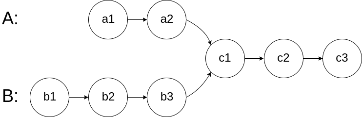
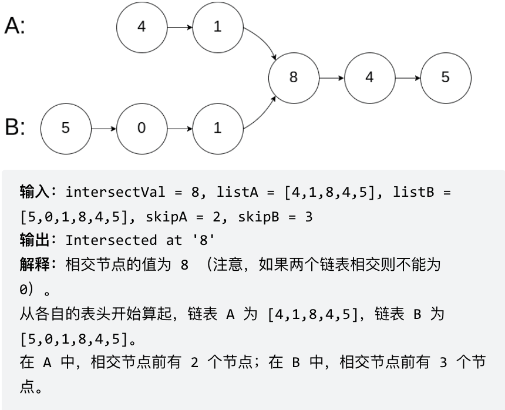
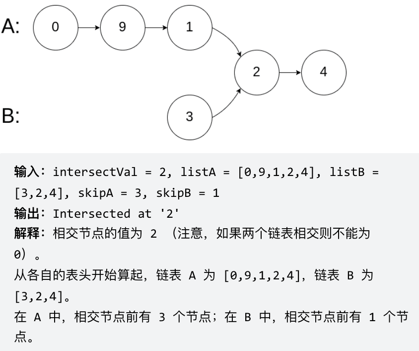
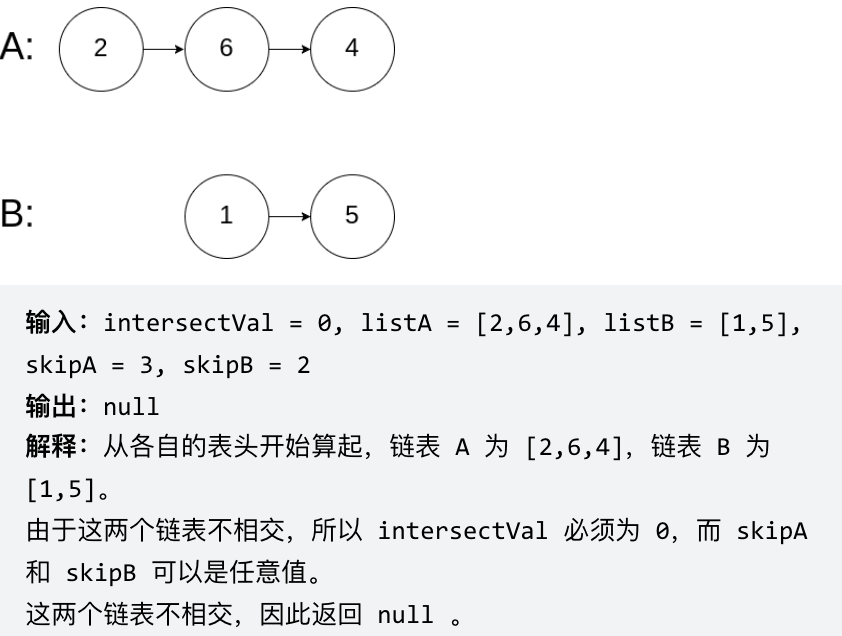
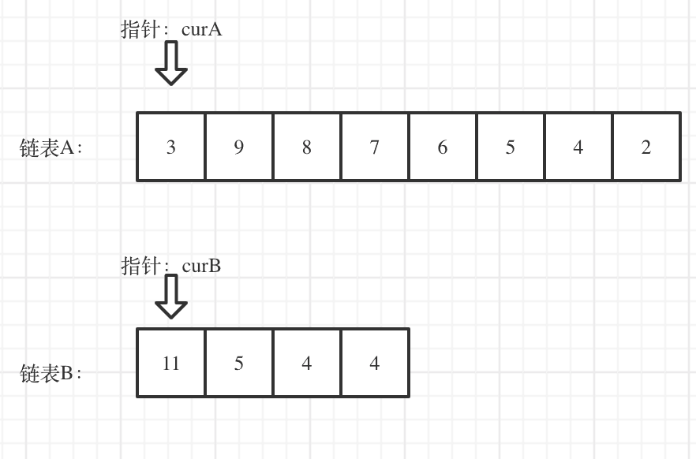
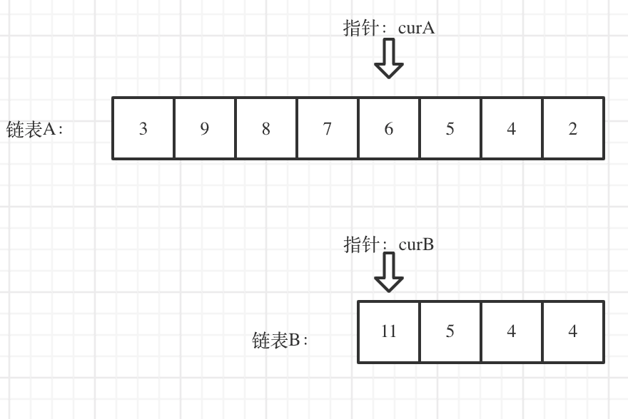

* [做專案（多個 C++、Java、Go、測試開發、前端（front end）專案）](https://www.programmercarl.com/other/kstar.html)
* [練習演算法（algorithm）（兩個月高強度學演算法）](https://www.programmercarl.com/xunlian/xunlianying.html)
* [背誦面試必考題（八股文）（40 天挑戰高頻面試題）](https://www.programmercarl.com/xunlian/bagu.html)


# 面試題 02.07. 鏈接串列（linked list）相交 

同：160.鏈接串列相交

[LeetCode 題目連結](https://leetcode.cn/problems/intersection-of-two-linked-lists-lcci/)

給你兩個單向鏈接串列（singly-linked list）的頭節點（head node） headA 和 headB，請你找出並回傳兩個單向鏈接串列相交的起始節點（node）。如果兩個鏈接串列沒有交點，回傳 null。

圖示兩個鏈接串列在節點 c1 開始相交：



題目資料保證整個鏈式結構中不存在環。

注意，函式（function）回傳結果後，鏈接串列必須保持其原始結構。

範例 1：



範例 2：



範例 3：




## 解題思路


簡單來說，就是求兩個鏈接串列交點節點的**指標（pointer）**。這裡同學們要注意，交點不是數值相等，而是指標相等。

為了方便舉例，假設節點元素（element）數值相等，則節點指標相等。

看如下兩個鏈接串列，目前 curA 指向鏈接串列 A 的頭節點，curB 指向鏈接串列 B 的頭節點：



我們求出兩個鏈接串列的長度，並求出兩個鏈接串列長度的差值，然後讓 curA 移動到與 curB 末尾對齊的位置，如圖：



此時我們就可以比較 curA 和 curB 是否相同，如果不相同，同時向後移動 curA 和 curB，如果遇到 curA == curB，則找到交點。

否則迴圈（loop）退出回傳空指標（null pointer）。

C++ 程式碼如下：

```CPP
class Solution {
public:
    ListNode *getIntersectionNode(ListNode *headA, ListNode *headB) {
        ListNode* curA = headA;
        ListNode* curB = headB;
        int lenA = 0, lenB = 0;
        while (curA != NULL) { // 求鏈接串列 A 的長度
            lenA++;
            curA = curA->next;
        }
        while (curB != NULL) { // 求鏈接串列 B 的長度
            lenB++;
            curB = curB->next;
        }
        curA = headA;
        curB = headB;
        // 讓 curA 為最長鏈接串列的頭，lenA 為其長度
        if (lenB > lenA) {
            swap (lenA, lenB);
            swap (curA, curB);
        }
        // 求長度差
        int gap = lenA - lenB;
        // 讓 curA 和 curB 在同一起點上（末尾位置對齊）
        while (gap--) {
            curA = curA->next;
        }
        // 遍歷 curA 和 curB，遇到相同則直接回傳
        while (curA != NULL) {
            if (curA == curB) {
                return curA;
            }
            curA = curA->next;
            curB = curB->next;
        }
        return NULL;
    }
};
```

* 時間複雜性（time complexity）：O(n + m)
* 空間複雜度（space complexity）：O(1)

## 其他語言版本

### Java：

```Java
(版本一)先行移動長鏈接串列實作同步移動
public class Solution {
    public ListNode getIntersectionNode(ListNode headA, ListNode headB) {
        ListNode curA = headA;
        ListNode curB = headB;
        int lenA = 0, lenB = 0;
        while (curA != null) { // 求鏈接串列 A 的長度
            lenA++;
            curA = curA.next;
        }
        while (curB != null) { // 求鏈接串列 B 的長度
            lenB++;
            curB = curB.next;
        }
        curA = headA;
        curB = headB;
        // 讓 curA 為最長鏈接串列的頭，lenA 為其長度
        if (lenB > lenA) {
            //1. swap (lenA, lenB);
            int tmpLen = lenA;
            lenA = lenB;
            lenB = tmpLen;
            //2. swap (curA, curB);
            ListNode tmpNode = curA;
            curA = curB;
            curB = tmpNode;
        }
        // 求長度差
        int gap = lenA - lenB;
        // 讓 curA 和 curB 在同一起點上（末尾位置對齊）
        while (gap-- > 0) {
            curA = curA.next;
        }
        // 遍歷 curA 和 curB，遇到相同則直接回傳
        while (curA != null) {
            if (curA == curB) {
                return curA;
            }
            curA = curA.next;
            curB = curB.next;
        }
        return null;
    }

}

(版本二) 合併鏈接串列實作同步移動
public class Solution {
    public ListNode getIntersectionNode(ListNode headA, ListNode headB) {
		// p1 指向 A 鏈接串列頭節點，p2 指向 B 鏈接串列頭節點
		ListNode p1 = headA, p2 = headB;
		while (p1 != p2) {
			// p1 走一步，如果走到 A 鏈接串列末尾，轉到 B 鏈接串列
			if (p1 == null) p1 = headB;
			else            p1 = p1.next;
			// p2 走一步，如果走到 B 鏈接串列末尾，轉到 A 鏈接串列
			if (p2 == null) p2 = headA;
			else            p2 = p2.next;
		}
		return p1;
    }
}
```

### Python：

```python

（版本一）求長度，同時出發

class Solution:
    def getIntersectionNode(self, headA: ListNode, headB: ListNode) -> ListNode:
        lenA, lenB = 0, 0
        cur = headA
        while cur:         # 求鏈接串列 A 的長度
            cur = cur.next 
            lenA += 1
        cur = headB 
        while cur:         # 求鏈接串列 B 的長度
            cur = cur.next 
            lenB += 1
        curA, curB = headA, headB
        if lenA > lenB:     # 讓 curB 為最長鏈接串列的頭，lenB 為其長度
            curA, curB = curB, curA
            lenA, lenB = lenB, lenA 
        for _ in range(lenB - lenA):  # 讓 curA 和 curB 在同一起點上（末尾位置對齊）
            curB = curB.next 
        while curA:         # 遍歷 curA 和 curB，遇到相同則直接回傳
            if curA == curB:
                return curA
            else:
                curA = curA.next 
                curB = curB.next
        return None 
```
```python
（版本二）求長度，同時出發（程式碼復用）
class Solution:
    def getIntersectionNode(self, headA: ListNode, headB: ListNode) -> ListNode:
        lenA = self.getLength(headA)
        lenB = self.getLength(headB)
        
        # 透過移動較長的鏈接串列，使兩鏈接串列長度相等
        if lenA > lenB:
            headA = self.moveForward(headA, lenA - lenB)
        else:
            headB = self.moveForward(headB, lenB - lenA)
        
        # 將兩個頭向前移動，直到它們相交
        while headA and headB:
            if headA == headB:
                return headA
            headA = headA.next
            headB = headB.next
        
        return None
    
    def getLength(self, head: ListNode) -> int:
        length = 0
        while head:
            length += 1
            head = head.next
        return length
    
    def moveForward(self, head: ListNode, steps: int) -> ListNode:
        while steps > 0:
            head = head.next
            steps -= 1
        return head
```
```python
（版本三）求長度，同時出發（程式碼復用 + 精簡）
class Solution:
    def getIntersectionNode(self, headA: ListNode, headB: ListNode) -> ListNode:
        dis = self.getLength(headA) - self.getLength(headB)
        
        # 透過移動較長的鏈接串列，使兩鏈接串列長度相等
        if dis > 0:
            headA = self.moveForward(headA, dis)
        else:
            headB = self.moveForward(headB, abs(dis))
        
        # 將兩個頭向前移動，直到它們相交
        while headA and headB:
            if headA == headB:
                return headA
            headA = headA.next
            headB = headB.next
        
        return None
    
    def getLength(self, head: ListNode) -> int:
        length = 0
        while head:
            length += 1
            head = head.next
        return length
    
    def moveForward(self, head: ListNode, steps: int) -> ListNode:
        while steps > 0:
            head = head.next
            steps -= 1
        return head
```
```python
（版本四）等比例法
# Definition for singly-linked list.
# class ListNode:
#     def __init__(self, x):
#         self.val = x
#         self.next = None


class Solution:
    def getIntersectionNode(self, headA: ListNode, headB: ListNode) -> ListNode:
        # 處理邊緣情況
        if not headA or not headB:
            return None
        
        # 在每個鏈接串列的頭部初始化兩個指標
        pointerA = headA
        pointerB = headB
        
        # 遍歷兩個鏈接串列直到指標相交
        while pointerA != pointerB:
            # 將指標向前移動一個節點
            pointerA = pointerA.next if pointerA else headB
            pointerB = pointerB.next if pointerB else headA
        
        # 如果相交，指標將位於交點節點，如果沒有交點，值為 None
        return pointerA
```

### Go:

```go
func getIntersectionNode(headA, headB *ListNode) *ListNode {
    curA := headA
    curB := headB
    lenA, lenB := 0, 0
    // 求 A，B 的長度
    for curA != nil {
        curA = curA.Next
        lenA++
    }
    for curB != nil {
        curB = curB.Next
        lenB++
    }
    var step int
    var fast, slow *ListNode
    // 請求長度差，並且讓更長的鏈接串列先走相差的長度
    if lenA > lenB {
        step = lenA - lenB
        fast, slow = headA, headB
    } else {
        step = lenB - lenA
        fast, slow = headB, headA
    }
    for i:=0; i < step; i++ {
        fast = fast.Next
    }
    // 遍歷兩個鏈接串列遇到相同則跳出遍歷
    for fast != slow {
        fast = fast.Next
        slow = slow.Next
    }
    return fast
}
```

two pointers

```go
func getIntersectionNode(headA, headB *ListNode) *ListNode {
    l1,l2 := headA, headB
    for l1 != l2 {
        if l1 != nil {
            l1 = l1.Next
        } else {
            l1 = headB
        }

        if l2 != nil {
            l2 = l2.Next
        } else {
            l2 = headA
        }
    }

    return l1
}
```

### JavaScript：

```js
var getListLen = function(head) {
    let len = 0, cur = head;
    while(cur) {
       len++;
       cur = cur.next;
    }
    return len;
}
var getIntersectionNode = function(headA, headB) {
    let curA = headA,curB = headB,
        lenA = getListLen(headA),   // 求鏈接串列 A 的長度
        lenB = getListLen(headB);  
    if(lenA < lenB) {       // 讓 curA 為最長鏈接串列的頭，lenA 為其長度
    
        // 交換變數注意加「分號」，兩個陣列交換變數在同一個作用域下時
        // 如果不加分號，下面兩條程式碼等同於一條程式碼: [curA, curB] = [lenB, lenA]
        
        [curA, curB] = [curB, curA];
        [lenA, lenB] = [lenB, lenA];
    }
    let i = lenA - lenB;   // 求長度差
    while(i-- > 0) {       // 讓 curA 和 curB 在同一起點上（末尾位置對齊）
        curA = curA.next;
    }
    while(curA && curA !== curB) {  // 遍歷 curA 和 curB，遇到相同則直接回傳
        curA = curA.next;
        curB = curB.next;
    }
    return curA;
};
```

### TypeScript：

```typescript
function getIntersectionNode(headA: ListNode | null, headB: ListNode | null): ListNode | null {
  let sizeA: number = 0,
    sizeB: number = 0;
  let curA: ListNode | null = headA,
    curB: ListNode | null = headB;
  while (curA) {
    sizeA++;
    curA = curA.next;
  }
  while (curB) {
    sizeB++;
    curB = curB.next;
  }
  curA = headA;
  curB = headB;
  if (sizeA < sizeB) {
    [sizeA, sizeB] = [sizeB, sizeA];
    [curA, curB] = [curB, curA];
  }
  let gap = sizeA - sizeB;
  while (gap-- && curA) {
    curA = curA.next;
  }
  while (curA && curB) {
    if (curA === curB) {
      return curA;
    }
    curA = curA.next;
    curB = curB.next;
  }
  return null;
};
```

### C：

```c
ListNode *getIntersectionNode(ListNode *headA, ListNode *headB) {
    ListNode *l = NULL, *s = NULL;
    int lenA = 0, lenB = 0, gap = 0;
    // 求出兩個鏈接串列的長度
    s = headA;
    while (s) {
        lenA ++;
        s = s->next;
    }
    s = headB;
    while (s) {
        lenB ++;
        s = s->next;
    }

    // 求出兩個鏈接串列長度差
    if (lenA > lenB) {
        l = headA, s = headB;
        gap = lenA - lenB;
    } else {
        l = headB, s = headA;
        gap = lenB - lenA;
    }

    // 尾部對齊
    while (gap--) l = l->next;
    // 移動，並檢查是否有相同的元素
    while (l) {
        if (l == s) return l;
        l = l->next, s = s->next;
    }

    return NULL;
}
```

### Scala:

```scala
object Solution {
  def getIntersectionNode(headA: ListNode, headB: ListNode): ListNode = {
    var lenA = 0 // headA 鏈接串列的長度
    var lenB = 0 // headB 鏈接串列的長度
    var tmp = headA // 臨時變數
    // 統計 headA 的長度
    while (tmp != null) {
      lenA += 1;
      tmp = tmp.next
    }
    // 統計 headB 的長度
    tmp = headB // 臨時變數賦值給 headB
    while (tmp != null) {
      lenB += 1
      tmp = tmp.next
    }
    // 因為傳遞過來的參數是不可變變數，所以需要重新定義
    var listA = headA
    var listB = headB
    // 兩個鏈接串列的長度差
    // 如果 gap>0，lenA>lenB，headA(listA) 鏈接串列往前移動 gap 步
    // 如果 gap<0，lenA<lenB，headB(listB) 鏈接串列往前移動 -gap 步
    var gap = lenA - lenB
    if (gap > 0) {
      // 因為不可以 i-=1，所以可以使用 for
      for (i <- 0 until gap) {
        listA = listA.next // 鏈接串列 headA(listA) 移動
      }
    } else {
      gap = math.abs(gap) // 此刻 gap 為負值，取絕對值
      for (i <- 0 until gap) {
        listB = listB.next
      }
    }
    // 現在兩個鏈接串列同時往前走，如果相等則回傳
    while (listA != null && listB != null) {
      if (listA == listB) {
        return listA
      }
      listA = listA.next
      listB = listB.next
    }
    // 如果鏈接串列沒有相交則回傳 null，return 可以省略
    null
  }
}
```
### C#
```csharp
public ListNode GetIntersectionNode(ListNode headA, ListNode headB)
{
    if (headA == null || headB == null) return null;
    ListNode cur1 = headA, cur2 = headB;
    while (cur1 != cur2)
    {
        cur1 = cur1 == null ? headB : cur1.next;
        cur2 = cur2 == null ? headA : cur2.next;
    }
    return cur1;
}
```

### Swift：
```swift
func getIntersectionNode(_ headA: ListNode?, _ headB: ListNode?) -> ListNode? {
    var lenA = 0
    var lenB = 0
    var nodeA = headA
    var nodeB = headB
    // 計算鏈接串列 A 和鏈接串列 B 的長度
    while nodeA != nil {
        lenA += 1
        nodeA = nodeA?.next
    }
    while nodeB != nil {
        lenB += 1
        nodeB = nodeB?.next
    }
    // 重置指標
    nodeA = headA
    nodeB = headB
    // 如果鏈接串列 A 更長，讓它先走 lenA-lenB 步
    if lenA > lenB {
        for _ in 0..<(lenA - lenB) {
            nodeA = nodeA?.next
        }
    } else if lenB > lenA {
        // 如果鏈接串列 B 更長，讓它先走 lenB-lenA 步
        for _ in 0..<(lenB - lenA) {
            nodeB = nodeB?.next
        }
    }
    // 同時遍歷兩個鏈接串列，尋找交點
    while nodeA !== nodeB {
        nodeA = nodeA?.next
        nodeB = nodeB?.next
    }
    return nodeA
}
```


